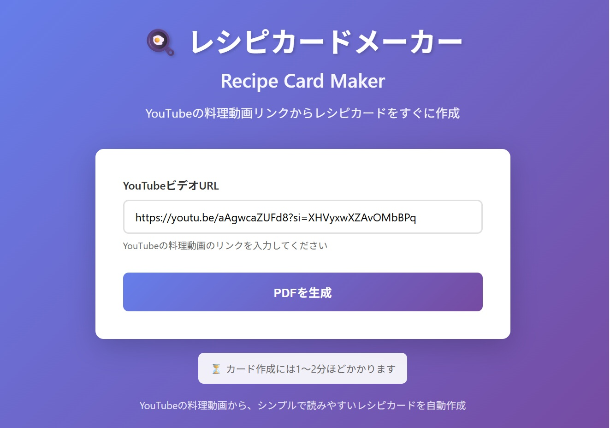
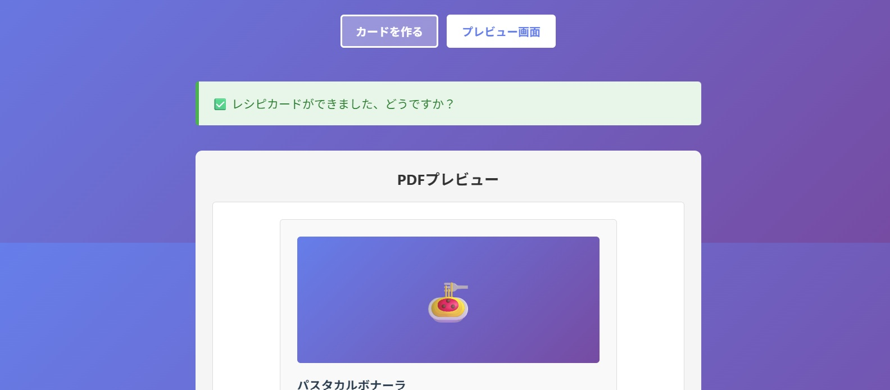

# 🍳 レシピカードメーカー (Recipe Card Maker)

## Claude Code Vibe Coding/app development demo 

このデモ用プロジェクトはClaude Codeを使ったVibe CodingでYouTubeの料理動画（またはショート動画）からレシピを自動抽出し、1ページのきれいなレシピカード（PDF）を自動生成するWebアプリケーションです

This project is Demo for using Claude Code to vibe code to develop a simple web application to enter a YouTube cooking video/short link to generate one-page PDF of the recipe from the video



YouTubeの料理動画（またはショート動画）のリンクを入力すると動画から自動生成されたレシピカード（PDF）のプレビューが表示されてPDFをダウンロード、のボタンをクリックすると生成された1ページPDFのレシピカードをダウンロードすることができます。



実際に完成したこのアプリを使って作成したレシピカード(PDF)の例：

<a href="https://github.com/morikaglobal/claude_code_vibe_coding1/blob/main/images/%E3%83%AC%E3%82%B7%E3%83%94%E3%82%AB%E3%83%BC%E3%83%89%E4%BE%8B%E3%81%9D%E3%81%AE1_%E3%81%8A%E3%81%95%E3%81%A4%E3%83%9D%E3%83%86%E3%83%88.pdf" target="_blank">レシピカード例その1_おさつポテト</a>

<a href="https://github.com/morikaglobal/claude_code_vibe_coding1/blob/main/images/%E3%83%AC%E3%82%B7%E3%83%94%E3%82%AB%E3%83%BC%E3%83%89%E4%BE%8B%E3%81%9D%E3%81%AE2_%E3%81%AB%E3%82%93%E3%81%98%E3%82%93%E3%81%AE%E3%83%9D%E3%82%BF%E3%83%BC%E3%82%B8%E3%83%A5.pdf" target="_blank">レシピカード例その2_にんじんのポタージュ</a>

## 機能

- **YouTube対応**: YouTubeビデオのURLを入力
- **自動抽出**: 動画の説明文・字幕からレシピを抽出
- **AI分析**: Claude APIでレシピを自動分析・整形
- **PDF生成**: 1ページに収まるきれいなPDFを自動生成
  - 動画のサムネイル画像を掲載(注*1)
  - 材料リスト
  - 調理手順
- **シンプルUI**: 使いやすいWebインターフェース

注*1 動画がフル動画ではなくショート動画だった場合、そもそも設定されているサムネイル画像が無いのでサムネイル画像が無い、または表示されない、などの場合はサムネイルの表示範囲にはショート動画なのでサムネイルが無い、と記載する仕様に変更した

## セットアップ

### 前提条件

- Python 3.9+
- Anthropic API キー

### インストール

1. **仮想環境を作成:**
```bash
python -m venv .venv
```

2. **仮想環境を有効化:**

**Windows - コマンドプロンプト（CMD）:**
```bash
.venv\Scripts\activate.bat
```

**Windows - PowerShell:**
```powershell
.\.venv\Scripts\Activate.ps1
```

3. **依存パッケージをインストール:**
```bash
pip install -r requirements.txt
```

4. **`.env` ファイルを作成:**
```bash
copy .env.example .env
```

5. **`.env` ファイルに Anthropic API キーを設定:**
```
ANTHROPIC_API_KEY=sk-...
```

### 実行

1. **仮想環境を有効化:**

**Windows - CMD:**
```bash
.venv\Scripts\activate.bat
```

**Windows - PowerShell:**
```powershell
.\.venv\Scripts\Activate.ps1
```

2. **アプリを起動:**
```bash
python app.py
```

ブラウザで `http://localhost:5000` にアクセス

## 使い方

1. YouTubeの料理動画URLを入力
2. 「PDFを生成」ボタンをクリック
3. 処理完了後、PDFプレビューが表示される
4. プレビューで内容を確認（ページネーション機能で前後のページを確認可能）
5. 「PDFをダウンロード」ボタンをクリックしてダウンロード開始

> **注意**: 初回実行時は1～2分かかる場合があります。

## ファイル構成

```
claude_recipe/
├── app.py                 # メインアプリケーション
├── requirements.txt       # Python依存パッケージ
├── .env.example          # 環境変数テンプレート
├── utils/
│   ├── __init__.py
│   ├── youtube_handler.py    # YouTube動画情報取得
│   ├── recipe_analyzer.py    # Claude APIでレシピ分析
│   └── pdf_generator.py      # PDF生成
├── templates/
│   └── index.html            # Webインターフェース
└── static/
    ├── style.css             # スタイル
    └── script.js             # クライアント処理
```

## 処理フロー

1. **YouTube情報取得** (`youtube_handler.py`)
   - 動画タイトル・説明文を取得
   - 字幕・キャプションを抽出
   - サムネイル画像を取得

2. **レシピ分析** (`recipe_analyzer.py`)
   - Claude APIを使用
   - 動画情報からレシピを抽出・分析
   - JSON形式で返却

3. **PDF生成** (`pdf_generator.py`)
   - 画像を上部に配置
   - 材料リストを記載
   - 調理手順を記載
   - 1ページに収まるよう自動調整

4. **PDFプレビュー表示**
   - PDF.js を使用してブラウザ上に表示
   - ページナビゲーション機能付き

5. **ダウンロード**
   - ユーザーがプレビューを確認後、ダウンロードボタンをクリック
   - PDFファイルがダウンロード開始

## トラブルシューティング

### Claude API エラー
- `.env` ファイルで `ANTHROPIC_API_KEY` が正しく設定されているか確認
- [Anthropic Console](https://console.anthropic.com/) でキーを確認

### YouTube 動画情報が取得できない
- YouTubeの仕様変更の可能性
- `yt-dlp` を更新: `pip install --upgrade yt-dlp`

### PDFが生成されない
- 動画の説明文や字幕が不足している可能性
- より詳しい説明のある動画を試す

## 技術スタック

- **Backend**: Flask
- **YouTube処理**: yt-dlp
- **AI**: Anthropic Claude API
- **PDF生成**: reportlab
- **画像処理**: Pillow
- **Frontend**: HTML/CSS/JavaScript

## ライセンス

MIT

## サポート

問題が発生した場合は、ログを確認してください：
- `app.py` を実行すると、詳細なログが表示されます
- `temp/` ディレクトリに一時ファイルが保存されます
